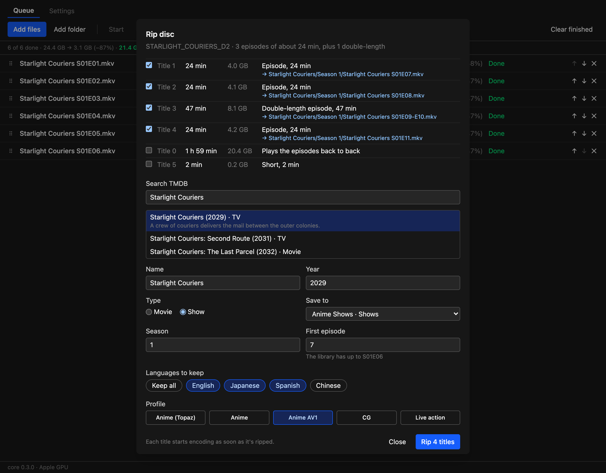
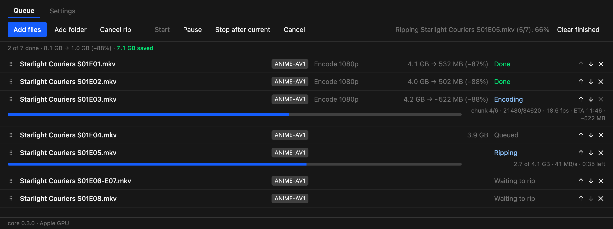
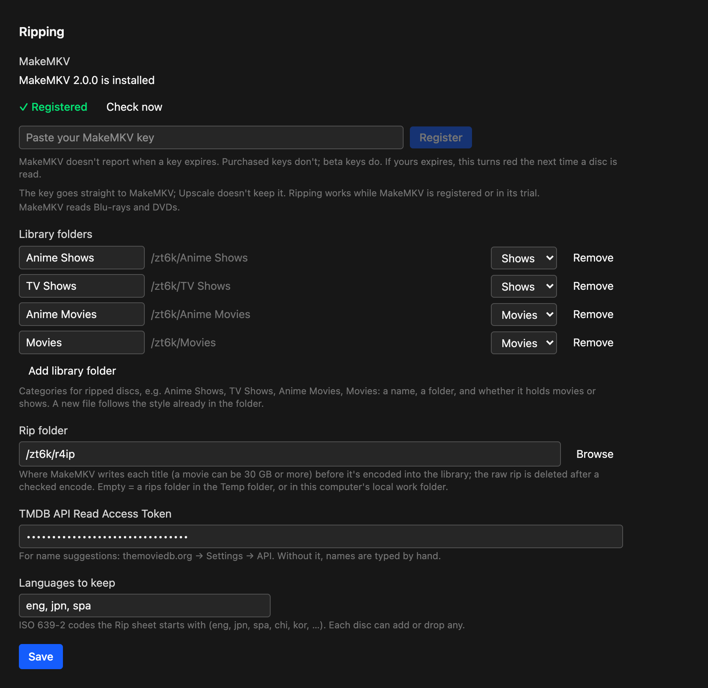

**Rip your discs in Upscale.** Insert a Blu-ray or DVD and Upscale reads it, picks the titles worth ripping, suggests Jellyfin names, rips with MakeMKV and encodes each title as soon as it's ripped. The finished files go straight into your library folders.

**Windows: encoding ready, ripping not tested yet.** The ripping code includes Windows drive detection, but it has only been run with a real drive on macOS.

## Disc ripping

**The Rip sheet opens when a disc goes in.** Upscale checks every few seconds for a new Blu-ray (`BDMV`) or DVD (`VIDEO_TS`), then reads it with MakeMKV. The sheet stays available from the queue's **Rip disc** button until you eject the disc.

**It picks the titles for you.** Every title is listed with its length and size, and a short reason for the pick. You can change any of the ticks.

- **Movies:** a feature of an hour or more that's at least twice as long as anything else is the main title. When two cuts are nearly identical, the bigger is ticked and the other is listed as an alternate cut.
- **Shows:** titles of similar length are treated as episodes, and a title about twice as long is a double episode.
- **Skipped:** "play all" titles, duplicate playlists, extras and trailers stay unticked.

**Names that match your library.** Search TMDB from the sheet to fill in the name and year, or type the name yourself. New files follow the style already in the folder:

- **Movies:** flat `Name (Year).mkv` files, or a folder per movie, whichever the library folder mostly uses. A second ticked title becomes another version.
- **Shows:** an existing show keeps its folder, file prefix, season folders (custom arc folders too) and episode-title style. A new show gets `Name (Year)/Season 1/Name S01E01.mkv`, and double episodes are named `S01E07-E08`.
- **First episode:** suggested from what's already there. If the library ends at S01E06, the disc starts at S01E07.

**Choose languages for each disc.** Chips show the languages actually on the disc, with your default set already on. **Keep all** keeps everything, and `"KeepLanguages": "all"` does the same in settings files.

**Every title is a queue row from the start.** Rows go from Waiting to rip, to Ripping (GB done, MB/s and time left), to encoding, all on the same row. Titles rip one at a time, and each starts encoding while the next one rips. Removing a waiting title skips it, removing the ripping title stops just that one, and **Cancel rip** stops the rest. The disc ejects when its last title is ripped, and MakeMKV's messages are in the row's Log tab.

**The raw rip is deleted after a checked encode.** Rips can be 30 GB or more, so they're deleted for good rather than sent to the Trash, but only if the finished file's length matches the rip's. If it doesn't match, the rip is kept and the log says so.

## New settings

**Settings → Ripping** has everything for discs:

- **MakeMKV:** its status and a field for your key. The key goes straight to MakeMKV and Upscale doesn't keep it.
- **Library folders:** named categories such as Anime Shows or Movies, each a folder marked as Movies or Shows. On the Rip sheet, **Save to** lists them and also takes any other folder for a single rip.
- **Rip folder:** where raw rips wait to be encoded.
- **TMDB API Read Access Token:** free from themoviedb.org → Settings → API. Without it, you type names by hand.
- **Languages to keep:** what each disc starts with (default `eng, jpn, spa`).

## MakeMKV

Upscale doesn't include MakeMKV, because its licence doesn't allow that. It only installs it for people who rip.

- **macOS:** Homebrew has disabled its MakeMKV cask, so Upscale can install it for you after you approve once in Settings → Ripping → **Install MakeMKV**. It checks the download against MakeMKV's hash list, which must verify against MakeMKV's PGP key. Update tools then keeps it current.
- **Windows:** installed and updated with winget (`GuinpinSoft.MakeMKV`).
- **Registration:** ripping works while MakeMKV is registered or in its trial. Once neither holds, the Rip button is greyed out with a note on what to do. You can still open the sheet to check titles and names, and encoding isn't affected.

## Queue

- **Drag to reorder.** Each row has a handle: drag it and a blue line shows where the row will land. The ↑ and ↓ buttons are still there.
- **"Larger" when files grow.** The savings bar used to say "saved" even when the new files were bigger. It now says, for example, `47 MB larger` in amber.
- **"Encoding" on encode-only jobs.** Live action and Anime AV1 jobs no longer say "Upscaling + encoding".

## Fixes

- **Wrong frame rate on VC-1 Blu-ray rips.** The upscale routes could read a rip's frame rate as under half the real one (10.9 fps instead of 23.976). Every frame was there, so the frame check passed and the job said Done, but the video played at under half speed against correct audio. The rate from ffprobe now corrects this. Except with inverse telecine, a job also fails, keeping its video file, if the finished video's speed doesn't match the source. **If you've encoded VC-1 sources with an earlier version, check that they play in sync.**
- **Comparison images.** The log counted images that were never written, and now warns when some couldn't be made.
- **Frame counts on Dolby Vision files.** ffprobe's output for these files wasn't parsed, so the count became 0. The queue had no total, percentage or usable ETA, and the frame check after the encode was skipped without an error. Both now use the real count.

## Files

- `Upscale_0.3.0_x64-setup.exe`: Windows installer (unsigned: SmartScreen may warn, More info → Run anyway).
- `Upscale_0.3.0_aarch64.dmg`: macOS app (ad-hoc signed: right-click → Open the first time).
- `upscale-cli.exe`, `upscale-cli-macos-arm64.tar.gz`: the command-line versions. Ripping is only in the app for now.
- `latest.json`, `Upscale_0.3.0_aarch64.app.tar.gz`: used by the in-app updater.

## Screenshots

These are mock-ups: the real interface, with an invented show, invented paths and made-up numbers.

**A disc on the Rip sheet**

**Ripping and encoding in the queue**

**Settings → Ripping**

