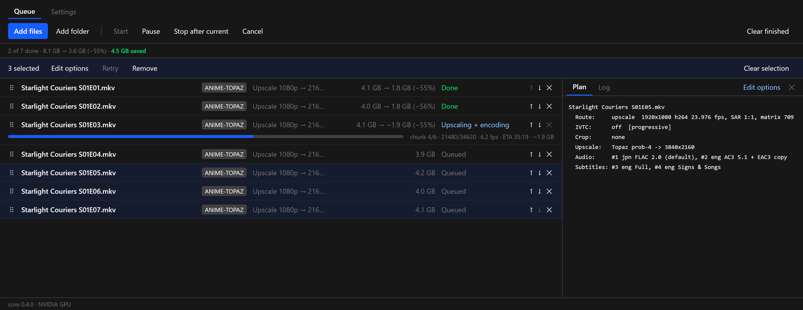
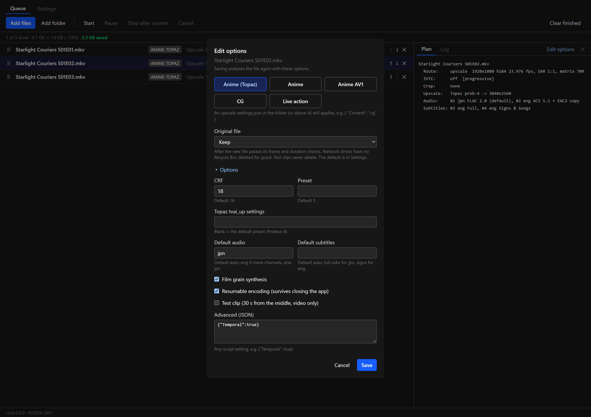
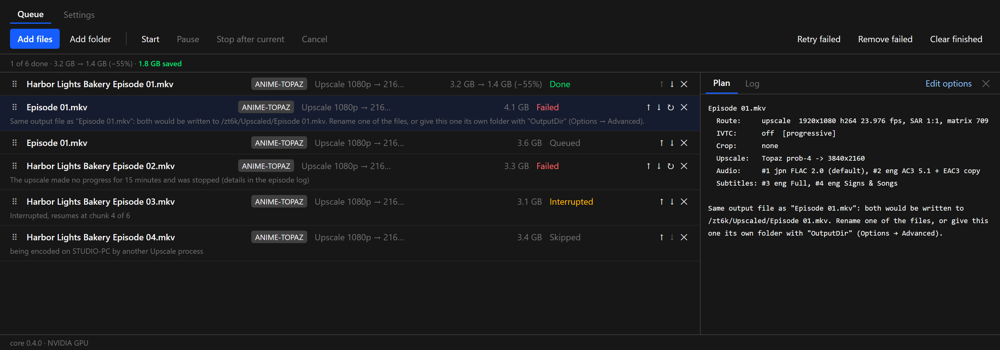
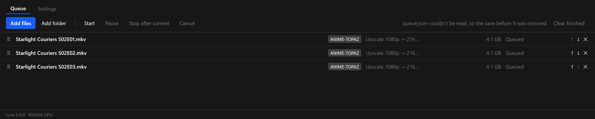

**Steadier long runs, and a queue that's easier to manage.** This release is mostly about what happens when things go wrong: a hung encoder, a power cut, a second copy of the app, two files with the same name. Each now ends with a clear message instead of a crash, a stuck job or a lost queue. The queue also gets multi-select, editing of queued jobs and whole-show folders.

**Windows: ready.** **macOS (Apple Silicon): ready.** Ejecting a disc after a rip is new on Windows and hasn't been tried with a real drive yet.

### Queue

**Select several jobs.** Ctrl-click (⌘-click on a Mac) adds or removes a row, and Shift-click takes every row in between. With two or more selected, a bar above the queue offers **Edit options**, **Retry** and **Remove** for all of them.

**Edit a job's options after adding it.** Queued, failed, cancelled, interrupted and skipped jobs have **Edit options** in their detail panel. The sheet opens with the job's current options, including anything in Advanced, and **Save** analyses the file again with the new ones. A ripped disc title keeps its library folder and still deletes its raw rip.

**Retry failed and Remove failed.** When anything in the queue has failed or was cancelled, the toolbar has a button for each.

**Add a whole show.** **Add folder** (or dropping a folder) now brings the folders below it too, up to four levels: a show folder adds every season. Each folder is planned on its own, so a season's episodes still share one analysis. Hidden folders and your Output folder are left out.

### When something goes wrong

**A job that hangs fails instead of waiting for ever.** If no new frame arrives for 15 minutes while the job isn't paused, it's stopped and fails with a reason in the queue. Before the first frame it waits 45 minutes, since the first run of a model can take a while to start. Retrying continues a resumable encode from its last finished chunk. HandBrake jobs get the same check.

**Two files with the same name.** Finished files are named after their sources, so `Episode 01.mkv` from two different shows would be written to the same file. Upscale now notices when a job is planned: the second one fails with a message naming the first, instead of being skipped as "output exists". Rename one of the files, or give it its own folder with `"OutputDir"` in Options → Advanced. Jobs that replace their original file aren't affected.

**A damaged queue or settings file is recovered.** Every save now keeps the one before it. If `queue.json` or `settings.json` can't be read when the app starts (after a power cut, for example), the previous save is restored and the status line says so. The unreadable file is kept next to it as `.json.bad`.

**Resumable encodes check their chunks.** A finished chunk is written to disk before it's marked done, and the mark records its size. When an encode resumes, each finished chunk is checked again, and one that was damaged is encoded again instead of failing the whole file at the end.

**One Upscale at a time.** Starting Upscale again brings the open window to the front. A second copy used to share the same queue and could encode the same file. Running `upscale-cli` alongside the app is also safe now: each skips files the other is working on, shown as "being encoded on *computer* by another Upscale process".

**Closing the window asks first** while a file is encoding or a disc is ripping.

**A job added while the queue runs gets the tools it needs.** Adding a Topaz job to a queue that started with encode-only jobs used to close the app. The tools are now set up before that job starts.

### Faster

- **4K and Live action jobs start sooner.** The frame count comes from the file's own statistics when they match its length, instead of reading the whole file first, which can take minutes for a large film on a network drive.
- **Analysing a folder is faster.** Up to four files are read at the same time.
- **The window stays responsive** while a slow network drive answers, and the Log tab reads only the end of a long log.
- **Disc watching on Windows** only looks at disc drives, so it no longer wakes sleeping hard drives or touches network drives every few seconds.
- **Long queues** redraw only the running row as progress updates.

### Fixes

- **Pause before HandBrake starts.** Pausing while a 4K job was still counting frames was ignored once HandBrake began. It now starts paused.
- **Tool downloads** continue where they stopped instead of starting over, and give up on a dead connection rather than waiting on it.
- **Two computers claiming the same episode** at the same moment could both start it. A claim is now complete before the other computer can see it.
- **Crashes leave a note** in `app.log`.
- **Windows: the disc is ejected** after its last title is ripped, as on macOS.

### Files

- `Upscale_0.4.0_x64-setup.exe`: Windows installer (unsigned: SmartScreen may warn, More info → Run anyway).
- `Upscale_0.4.0_aarch64.dmg`: macOS app (ad-hoc signed: right-click → Open the first time).
- `upscale-cli.exe`, `upscale-cli-macos-arm64.tar.gz`: the command-line versions.
- `latest.json`, `Upscale_0.4.0_aarch64.app.tar.gz`: used by the in-app updater.

### Screenshots

These are mock-ups: the real interface, with invented shows, invented paths and made-up numbers.

**Several jobs selected**

**Editing a queued job's options**

**Clear reasons when a job can't run**

**A damaged queue file, restored**

