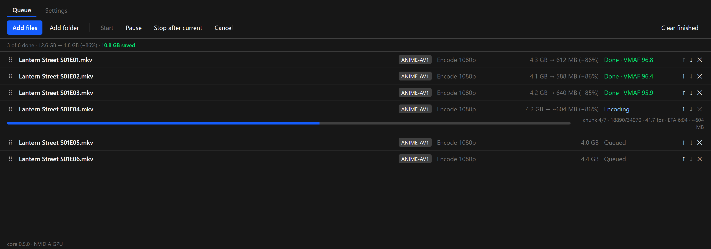
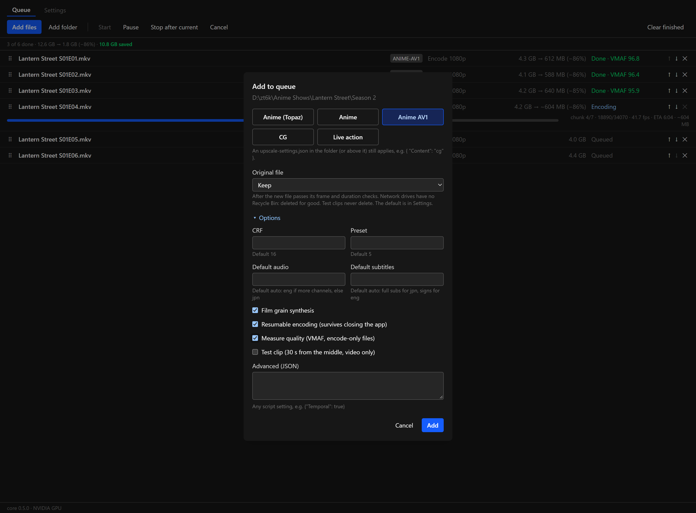
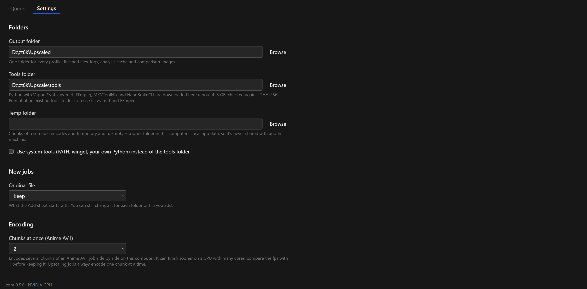
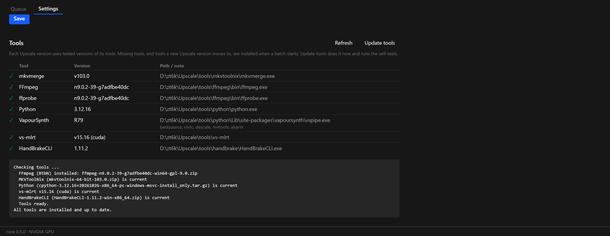

**Tested tools, faster Anime AV1, and a quality score.** Every computer on the same Upscale version now runs the same tool versions. Anime AV1 jobs can encode several chunks at once. Encode-only jobs can measure their own quality with VMAF.

**Windows: ready.** **macOS (Apple Silicon): ready.**

### Tools that change only with Upscale

**Each Upscale version installs exact, tested tool versions.** The tools folder used to take the newest release of Python, FFmpeg, MKVToolNix, HandBrakeCLI, 7-Zip and vs-mlrt, so a release made upstream could break a new install. Upscale 0.5.0 installs these, each checked against its SHA-256:

- FFmpeg 9.0.2 (BtbN build, with SVT-AV1)
- MKVToolNix 103.0
- HandBrakeCLI 1.11.2
- Python 3.12.16 with VapourSynth R79 and its plugins
- vs-mlrt v15.16
- 7-Zip 26.05

New tool versions arrive with Upscale updates. **Update tools** checks the tools against the versions this release expects and installs any that differ, then runs the self-tests. Tools that are already right aren't downloaded again.

**After updating, FFmpeg is downloaded once (about 190 MB).** Earlier versions installed BtbN's daily build, which BtbN deletes after a few weeks. Upscale now uses a month-end build, which BtbN keeps.

Not affected: MakeMKV stays current, since its trial and beta keys need that. Tools from **Use system tools** (winget or Homebrew) are also unchanged, and on macOS that's always the case.

### Faster Anime AV1

**Encode several chunks at once.** Settings → Encoding → **Chunks at once (Anime AV1)** runs up to three encoders side by side on a resumable Anime AV1 job. On a CPU with many cores one encoder can leave cores idle, and two or three can finish sooner. How much sooner depends on the CPU, so compare the fps with **1** before you keep it. It starts at 1, so nothing changes until you choose more.

Upscaling profiles always encode one chunk at a time: the GPU is already busy with one. The queue row shows progress for the whole file. If one chunk fails, the others stop, and a retry continues from the chunks that finished.

### Quality score

**Measure quality (VMAF).** Tick **Measure quality (VMAF, encode-only files)** in the Add sheet's Options, or put `"Vmaf": true` in a folder's `upscale-settings.json`. After the encode, Upscale compares the finished file with its source and shows the score on the row (**Done · VMAF 96.4**) and in the episode log. Above 95 is usually hard to tell from the source.

It works for files encoded without upscaling: Anime AV1, Live action and 4K sources. An upscale has no source of the same size to compare with, so upscaled files, inverse-telecined files and test clips are skipped, with the reason in the log. Every 5th frame is scored, and 4K sources use VMAF's 4K model. Measuring reads the whole file again, so it adds a few minutes per episode.

### Fixes

- **Anime (vs-mlrt) on AMD and Intel graphics.** The tools folder asked vs-mlrt for a Vulkan package it doesn't publish, so the profile couldn't install on these cards. It now installs vs-mlrt's package for non-NVIDIA cards. This hasn't been tried with an AMD or Intel card yet.
- **Long queues** scroll and update more smoothly: rows off screen aren't drawn.

### Files

- `Upscale_0.5.0_x64-setup.exe`: Windows installer (unsigned: SmartScreen may warn, More info → Run anyway).
- `Upscale_0.5.0_aarch64.dmg`: macOS app (ad-hoc signed: right-click → Open the first time).
- `upscale-cli.exe`, `upscale-cli-macos-arm64.tar.gz`: the command-line versions. They use the app's **Chunks at once** setting.
- `latest.json`, `Upscale_0.5.0_aarch64.app.tar.gz`: used by the in-app updater.

### Screenshots

These are mock-ups: the real interface, with an invented show, invented paths and made-up numbers.

**A season of Anime AV1 jobs with their VMAF scores**

**Measure quality in the Add sheet**

**Settings → Encoding**

**Update tools with tested versions**

