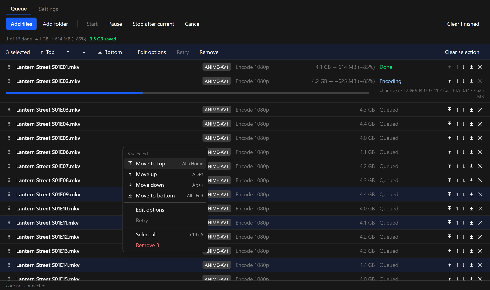
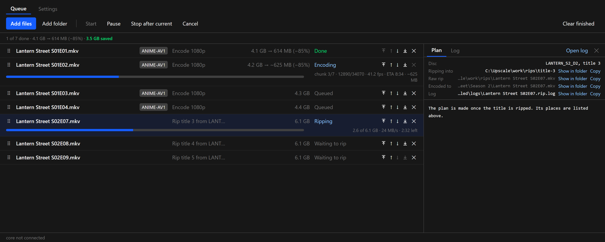
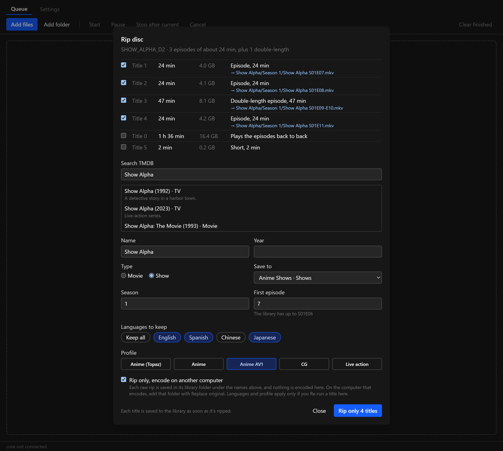

**A queue that's easier to manage, tidier audio and subtitle tracks, and Rip only.** Move whole selections in one go, send episodes to the top or bottom, and see where every file is. Finished files now put the default audio first and give subtitle tracks clear names. A disc can be ripped on one computer and encoded on another.

**Windows: ready.** **macOS (Apple Silicon): ready.**

### Moving jobs around the queue

- **Drag a selection.** Select rows with Ctrl-click or Shift-click, then drag any of them by its handle (⠿): all the selected rows move together, in their queue order. A label next to the pointer shows how many jobs you're dragging.
- **The list scrolls while you drag.** Hold the pointer near the top or bottom edge of the list and it scrolls, faster closer to the edge. A job can go from row 150 to row 3 in one drag.
- **Move to top and Move to bottom** on every row, next to ↑ and ↓. With several rows selected, the selection bar has **Top**, ↑, ↓ and **Bottom**.
- **Right-click a row** for Move to top, Move up, Move down, Move to bottom, Edit options, Retry, Select all and Remove. On a selected row, the menu acts on the whole selection.
- **Keyboard:**
  - ↑ / ↓ pick the previous or next row, and Home / End jump to the first or last. Shift extends the selection.
  - Ctrl+A selects everything, and Esc clears the selection.
  - Alt+↑ / Alt+↓ move the selected rows one place, and Alt+Home / Alt+End move them to the top or bottom.
  - On a Mac, use ⌘ for Ctrl and Option for Alt; Home and End are Fn+← and Fn+→.
- **Moved rows stay in view**, so you can see where they landed.

### Where each file is

- **The plan starts with the file's location.** `Source:` shows the full path, and `Saves to:` shows where the finished file goes, or "in place of the source" with Replace original.
- **The detail panel lists every place**, each with **Show in folder** and **Copy**:
  - A file: its source, its output (or where it will be saved, in grey until it exists), and its log.
  - A disc title: the disc and title number, the folder it's ripping into, the raw rip, and where the encode goes in the library.
  - Long paths are cut at the start, so the file name stays visible.
- **Show in folder works before the file exists**: it opens the folder the file will go into.

### Rip only: encode on another computer

Tick **Rip only, encode on another computer** in the Rip sheet:

- **What it does:** each title rips as usual, and the raw rip is saved straight into its library folder under the name the sheet shows (`…/Season 1/Show S01E07.mkv`). Nothing is encoded on this computer.
- **On the computer that encodes:** add that season or movie folder with **Replace original**, and the encode replaces the raw rip in place. Computers sharing an output folder already avoid working on the same file.
- **Checks before ripping:** a rip doesn't start if a file with one of those names already exists, or if the library's drive lacks the space.
- **Saving to a network folder:** if the folder drops for a moment, Upscale retries for about 8 minutes. If it still can't save, the rip stays in the Rip folder and the row says where.
- **Afterwards:** a rip-only row ends as Done with its library path. **Re-run** encodes it on this computer instead, in place.

### Audio and subtitle tracks

- **TrueHD Atmos stays the default audio.** TrueHD was meant to stay default over its DD+ copy, but the rule only recognised plain "TrueHD", so an Atmos track lost the default to the DD+ track. Both now stay default, wherever they sit in the language's tracks (the one with the most channels, leaving out commentary). Files encoded before 0.7 keep DD+ as their default.
- **The default audio comes first.** When the DD+ track is the default, it's now the first audio track in the file, followed by the original audio. Players that ignore the default flag start on the right track. A default original track (TrueHD) goes first the same way.
- **Subtitle tracks are named for their language and kind**, in every language you keep:

| The source's name has | New name |
|---|---|
| nothing special (or something meaningless) | **English Subtitles**, **French Subtitles** |
| SDH, "hearing impaired" or CC | **English SDH**, **Spanish SDH** |
| PGS | **English PGS**, **Spanish PGS** |
| forced (flag or name) | **English Forced** |
| commentary | **English Commentary** |
| signs and songs | **English Signs and Songs**, **Japanese Signs and Songs** |
| dubtitles | **English Dubtitles** |

- **Unchanged:** signs-and-songs tracks are still found by name, or by size under Auto, and are still the default subtitles for English audio.
- **New name for English signs tracks:** they used to be called just "Signs and Songs". Files encoded before 0.7 keep that name.
- **Tracks that would get the same name keep their original names.** For example, "Honorifics" and "No honorifics" stay distinguishable.
- **The plan shows each rename** as a `Rename S:` line.

### Files

- `Upscale_0.7.0_x64-setup.exe`: Windows installer (unsigned: SmartScreen may warn, More info → Run anyway).
- `Upscale_0.7.0_aarch64.dmg`: macOS app (ad-hoc signed: right-click → Open the first time).
- `upscale-cli.exe`, `upscale-cli-macos-arm64.tar.gz`: the command-line versions.
- `latest.json`, `Upscale_0.7.0_aarch64.app.tar.gz`: used by the in-app updater.

### Screenshots

These are mock-ups: the real interface, with invented shows, invented paths and made-up numbers.

**Three episodes selected, with the selection bar and the right-click menu**

**Where a ripping title's files are**

**Rip only in the Rip sheet**

