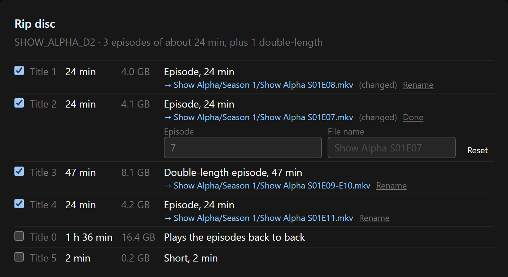

**Rename each title before ripping.** Some discs store their episodes out of order, so the names the Rip sheet counts out can land on the wrong episodes. Each title can now take its own episode number or file name.

**Windows: ready.** **macOS (Apple Silicon): ready.**

### Renaming titles in the Rip sheet

- **Rename** next to each ticked title's file name opens two fields:
  - **Episode:** type the right episode number. Only that title changes; the others keep their numbers. With TMDB episode titles in your library's names, the title follows the new number.
  - **File name:** type any name. It's saved in the same season (or movie) folder, `.mkv` is optional, and characters Windows can't use are cleaned up as usual.
- **A disc with episodes swapped**, say 1 and 2: set the first title to 2 and the second to 1.
- Renamed titles show **(changed)**, and **Reset** puts the counted name back.
- **No two titles share a name.** While a swap is half done, both titles turn red ("Another title has this name too"), and Rip stays off until it's fixed.
- Works with **Rip only** too: the raw rips are saved under the names you set.

### Files

- `Upscale_0.8.0_x64-setup.exe`: Windows installer (unsigned: SmartScreen may warn, More info → Run anyway).
- `Upscale_0.8.0_aarch64.dmg`: macOS app (ad-hoc signed: right-click → Open the first time).
- `upscale-cli.exe`, `upscale-cli-macos-arm64.tar.gz`: the command-line versions.
- `latest.json`, `Upscale_0.8.0_aarch64.app.tar.gz`: used by the in-app updater.

### Screenshot

This is a mock-up: the real interface, with an invented show and made-up numbers.

**The first two episodes swapped**

