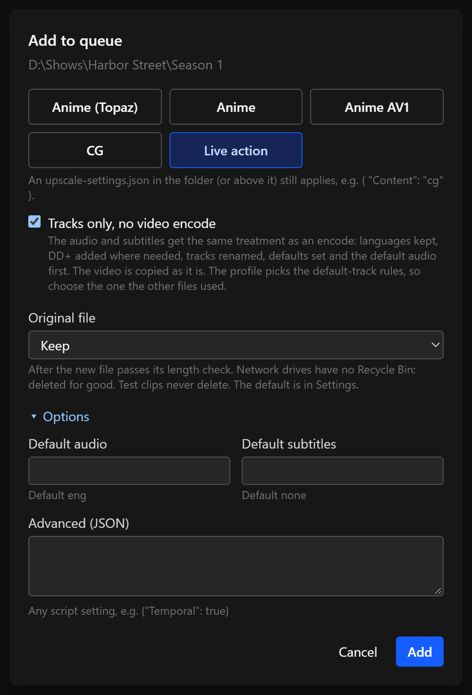

**Tracks only: match the audio and subtitles without a video encode.** For files whose picture is already fine but whose tracks don't match the rest of the library, Upscale can now redo just the audio and subtitles and copy the video as it is.

**Windows: ready.** **macOS (Apple Silicon): ready.**

### Tracks only

- Tick **Tracks only, no video encode** in the Add sheet (or Edit options for a waiting job).
- The audio and subtitles get the same treatment as an encode:
  - the same languages are kept,
  - DD+ is added where needed,
  - tracks are renamed,
  - the defaults are set, and the default audio goes first.
- **The video is copied bit for bit.** No upscale, no encode, no frame checks; the new file only has to pass its length check before the Original file choice (Keep, Delete or Replace) applies.
- **Pick the profile the other files used.** It still decides which audio and subtitles become the default. The video settings (CRF, preset, denoise, Topaz, film grain, resumable encoding, VMAF, test clip) are hidden, since they don't apply.
- The queue shows these jobs as **Tracks only**, and the plan says the video is copied as it is.

### Also in every encode

- **The video track loses its old name and description.** Rips and downloads often carry a title or description text on the video track; the finished file no longer keeps it.
- **No second DD+.** A file that already has a DD+ (E-AC-3) track in a language gets no extra one in that language. When there's no DD+ yet and the source audio is DTS, FLAC or PCM, the new DD+ becomes the default.

### Files

- `Upscale_0.9.0_x64-setup.exe`: Windows installer (unsigned: SmartScreen may warn, More info → Run anyway).
- `Upscale_0.9.0_aarch64.dmg`: macOS app (ad-hoc signed: right-click → Open the first time).
- `upscale-cli.exe`, `upscale-cli-macos-arm64.tar.gz`: the command-line versions. Use `--set TracksOnly=true`.
- `latest.json`, `Upscale_0.9.0_aarch64.app.tar.gz`: used by the in-app updater.

### Screenshot

This is a mock-up: the real interface, with an invented show.

**A season added with Tracks only**

