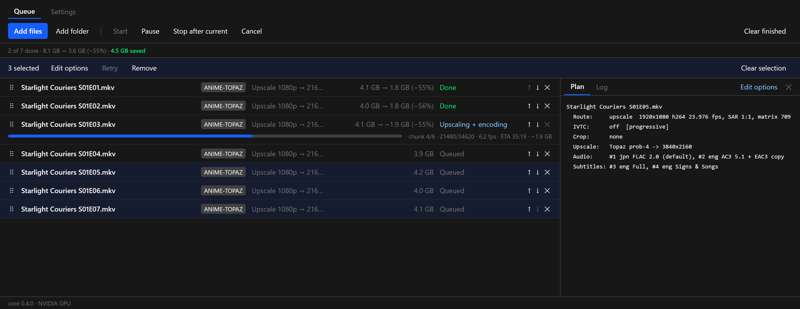
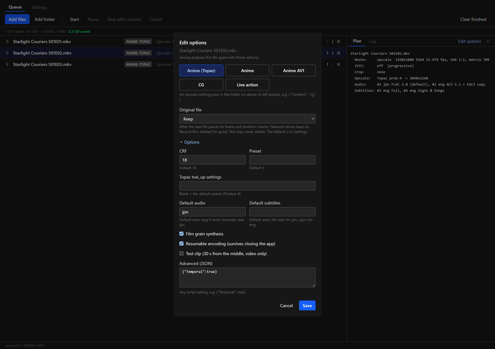
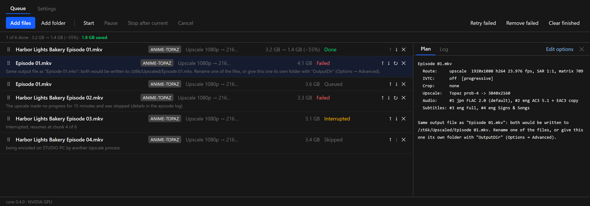
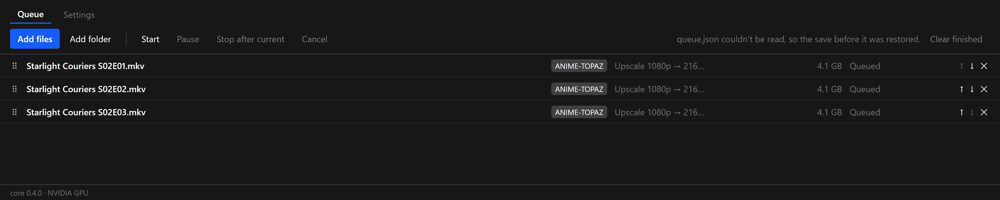
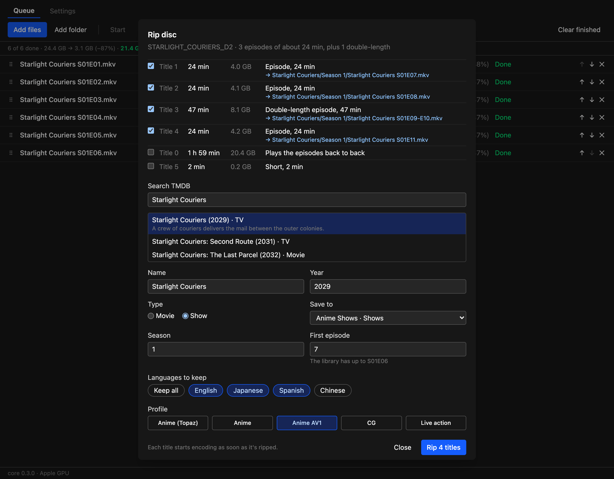
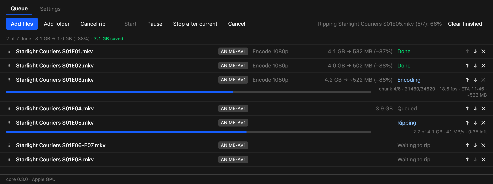
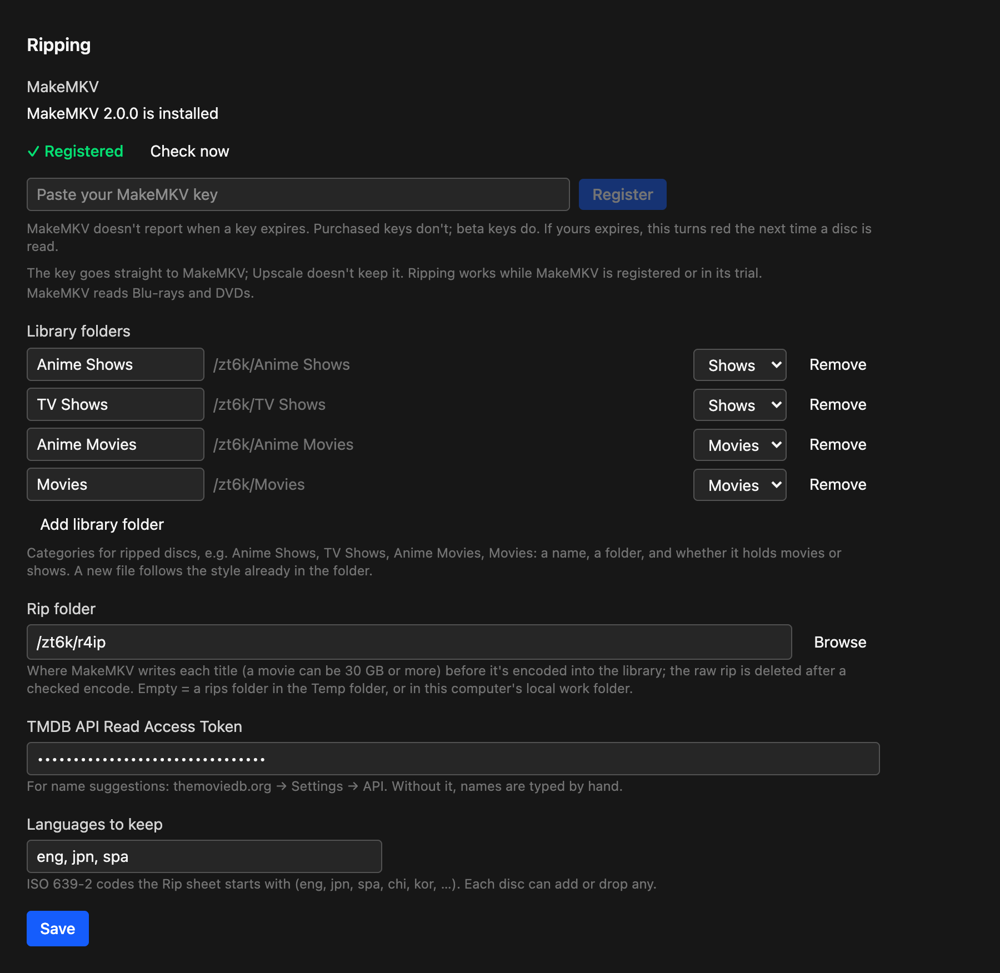

# Changelog

Every Upscale release, newest first. Each section is the release's notes from `.github/release-notes/`, as shown on GitHub and in the app's update banner.

## v0.4.0

**Steadier long runs, and a queue that's easier to manage.** This release is mostly about what happens when things go wrong: a hung encoder, a power cut, a second copy of the app, two files with the same name. Each now ends with a clear message instead of a crash, a stuck job or a lost queue. The queue also gets multi-select, editing of queued jobs and whole-show folders.

**Windows: ready.** **macOS (Apple Silicon): ready.** Ejecting a disc after a rip is new on Windows and hasn't been tried with a real drive yet.

#### Queue

**Select several jobs.** Ctrl-click (⌘-click on a Mac) adds or removes a row, and Shift-click takes every row in between. With two or more selected, a bar above the queue offers **Edit options**, **Retry** and **Remove** for all of them.

**Edit a job's options after adding it.** Queued, failed, cancelled, interrupted and skipped jobs have **Edit options** in their detail panel. The sheet opens with the job's current options, including anything in Advanced, and **Save** analyses the file again with the new ones. A ripped disc title keeps its library folder and still deletes its raw rip.

**Retry failed and Remove failed.** When anything in the queue has failed or was cancelled, the toolbar has a button for each.

**Add a whole show.** **Add folder** (or dropping a folder) now brings the folders below it too, up to four levels: a show folder adds every season. Each folder is planned on its own, so a season's episodes still share one analysis. Hidden folders and your Output folder are left out.

#### When something goes wrong

**A job that hangs fails instead of waiting for ever.** If no new frame arrives for 15 minutes while the job isn't paused, it's stopped and fails with a reason in the queue. Before the first frame it waits 45 minutes, since the first run of a model can take a while to start. Retrying continues a resumable encode from its last finished chunk. HandBrake jobs get the same check.

**Two files with the same name.** Finished files are named after their sources, so `Episode 01.mkv` from two different shows would be written to the same file. Upscale now notices when a job is planned: the second one fails with a message naming the first, instead of being skipped as "output exists". Rename one of the files, or give it its own folder with `"OutputDir"` in Options → Advanced. Jobs that replace their original file aren't affected.

**A damaged queue or settings file is recovered.** Every save now keeps the one before it. If `queue.json` or `settings.json` can't be read when the app starts (after a power cut, for example), the previous save is restored and the status line says so. The unreadable file is kept next to it as `.json.bad`.

**Resumable encodes check their chunks.** A finished chunk is written to disk before it's marked done, and the mark records its size. When an encode resumes, each finished chunk is checked again, and one that was damaged is encoded again instead of failing the whole file at the end.

**One Upscale at a time.** Starting Upscale again brings the open window to the front. A second copy used to share the same queue and could encode the same file. Running `upscale-cli` alongside the app is also safe now: each skips files the other is working on, shown as "being encoded on *computer* by another Upscale process".

**Closing the window asks first** while a file is encoding or a disc is ripping.

**A job added while the queue runs gets the tools it needs.** Adding a Topaz job to a queue that started with encode-only jobs used to close the app. The tools are now set up before that job starts.

#### Faster

- **4K and Live action jobs start sooner.** The frame count comes from the file's own statistics when they match its length, instead of reading the whole file first, which can take minutes for a large film on a network drive.
- **Analysing a folder is faster.** Up to four files are read at the same time.
- **The window stays responsive** while a slow network drive answers, and the Log tab reads only the end of a long log.
- **Disc watching on Windows** only looks at disc drives, so it no longer wakes sleeping hard drives or touches network drives every few seconds.
- **Long queues** redraw only the running row as progress updates.

#### Fixes

- **Pause before HandBrake starts.** Pausing while a 4K job was still counting frames was ignored once HandBrake began. It now starts paused.
- **Tool downloads** continue where they stopped instead of starting over, and give up on a dead connection rather than waiting on it.
- **Two computers claiming the same episode** at the same moment could both start it. A claim is now complete before the other computer can see it.
- **Crashes leave a note** in `app.log`.
- **Windows: the disc is ejected** after its last title is ripped, as on macOS.

#### Files

- `Upscale_0.4.0_x64-setup.exe`: Windows installer (unsigned: SmartScreen may warn, More info → Run anyway).
- `Upscale_0.4.0_aarch64.dmg`: macOS app (ad-hoc signed: right-click → Open the first time).
- `upscale-cli.exe`, `upscale-cli-macos-arm64.tar.gz`: the command-line versions.
- `latest.json`, `Upscale_0.4.0_aarch64.app.tar.gz`: used by the in-app updater.

#### Screenshots

These are mock-ups: the real interface, with invented shows, invented paths and made-up numbers.

**Several jobs selected**



**Editing a queued job's options**



**Clear reasons when a job can't run**



**A damaged queue file, restored**



## v0.3.0

**Rip your discs in Upscale.** Insert a Blu-ray or DVD and Upscale reads it, picks the titles worth ripping, suggests Jellyfin names, rips with MakeMKV and encodes each title as soon as it's ripped. The finished files go straight into your library folders.

**Windows: encoding ready, ripping not tested yet.** The ripping code includes Windows drive detection, but it has only been run with a real drive on macOS.

### Disc ripping

**The Rip sheet opens when a disc goes in.** Upscale checks every few seconds for a new Blu-ray (`BDMV`) or DVD (`VIDEO_TS`), then reads it with MakeMKV. The sheet stays available from the queue's **Rip disc** button until you eject the disc.

**It picks the titles for you.** Every title is listed with its length and size, and a short reason for the pick. You can change any of the ticks.

- **Movies:** a feature of an hour or more that's at least twice as long as anything else is the main title. When two cuts are nearly identical, the bigger is ticked and the other is listed as an alternate cut.
- **Shows:** titles of similar length are treated as episodes, and a title about twice as long is a double episode.
- **Skipped:** "play all" titles, duplicate playlists, extras and trailers stay unticked.

**Names that match your library.** Search TMDB from the sheet to fill in the name and year, or type the name yourself. New files follow the style already in the folder:

- **Movies:** flat `Name (Year).mkv` files, or a folder per movie, whichever the library folder mostly uses. A second ticked title becomes another version.
- **Shows:** an existing show keeps its folder, file prefix, season folders (custom arc folders too) and episode-title style. A new show gets `Name (Year)/Season 1/Name S01E01.mkv`, and double episodes are named `S01E07-E08`.
- **First episode:** suggested from what's already there. If the library ends at S01E06, the disc starts at S01E07.

**Choose languages for each disc.** Chips show the languages actually on the disc, with your default set already on. **Keep all** keeps everything, and `"KeepLanguages": "all"` does the same in settings files.

**Every title is a queue row from the start.** Rows go from Waiting to rip, to Ripping (GB done, MB/s and time left), to encoding, all on the same row. Titles rip one at a time, and each starts encoding while the next one rips. Removing a waiting title skips it, removing the ripping title stops just that one, and **Cancel rip** stops the rest. The disc ejects when its last title is ripped, and MakeMKV's messages are in the row's Log tab.

**The raw rip is deleted after a checked encode.** Rips can be 30 GB or more, so they're deleted for good rather than sent to the Trash, but only if the finished file's length matches the rip's. If it doesn't match, the rip is kept and the log says so.

### New settings

**Settings → Ripping** has everything for discs:

- **MakeMKV:** its status and a field for your key. The key goes straight to MakeMKV and Upscale doesn't keep it.
- **Library folders:** named categories such as Anime Shows or Movies, each a folder marked as Movies or Shows. On the Rip sheet, **Save to** lists them and also takes any other folder for a single rip.
- **Rip folder:** where raw rips wait to be encoded.
- **TMDB API Read Access Token:** free from themoviedb.org → Settings → API. Without it, you type names by hand.
- **Languages to keep:** what each disc starts with (default `eng, jpn, spa`).

### MakeMKV

Upscale doesn't include MakeMKV, because its licence doesn't allow that. It only installs it for people who rip.

- **macOS:** Homebrew has disabled its MakeMKV cask, so Upscale can install it for you after you approve once in Settings → Ripping → **Install MakeMKV**. It checks the download against MakeMKV's hash list, which must verify against MakeMKV's PGP key. Update tools then keeps it current.
- **Windows:** installed and updated with winget (`GuinpinSoft.MakeMKV`).
- **Registration:** ripping works while MakeMKV is registered or in its trial. Once neither holds, the Rip button is greyed out with a note on what to do. You can still open the sheet to check titles and names, and encoding isn't affected.

### Queue

- **Drag to reorder.** Each row has a handle: drag it and a blue line shows where the row will land. The ↑ and ↓ buttons are still there.
- **"Larger" when files grow.** The savings bar used to say "saved" even when the new files were bigger. It now says, for example, `47 MB larger` in amber.
- **"Encoding" on encode-only jobs.** Live action and Anime AV1 jobs no longer say "Upscaling + encoding".

### Fixes

- **Wrong frame rate on VC-1 Blu-ray rips.** The upscale routes could read a rip's frame rate as under half the real one (10.9 fps instead of 23.976). Every frame was there, so the frame check passed and the job said Done, but the video played at under half speed against correct audio. The rate from ffprobe now corrects this. Except with inverse telecine, a job also fails, keeping its video file, if the finished video's speed doesn't match the source. **If you've encoded VC-1 sources with an earlier version, check that they play in sync.**
- **Comparison images.** The log counted images that were never written, and now warns when some couldn't be made.
- **Frame counts on Dolby Vision files.** ffprobe's output for these files wasn't parsed, so the count became 0. The queue had no total, percentage or usable ETA, and the frame check after the encode was skipped without an error. Both now use the real count.

### Files

- `Upscale_0.3.0_x64-setup.exe`: Windows installer (unsigned: SmartScreen may warn, More info → Run anyway).
- `Upscale_0.3.0_aarch64.dmg`: macOS app (ad-hoc signed: right-click → Open the first time).
- `upscale-cli.exe`, `upscale-cli-macos-arm64.tar.gz`: the command-line versions. Ripping is only in the app for now.
- `latest.json`, `Upscale_0.3.0_aarch64.app.tar.gz`: used by the in-app updater.

### Screenshots

These are mock-ups: the real interface, with an invented show, invented paths and made-up numbers.

**A disc on the Rip sheet**



**Ripping and encoding in the queue**



**Settings → Ripping**



## v0.2.0

**Windows: ready.** **macOS (Apple Silicon): ready.** macOS has now been tested on a real Mac: the test suite passes, the Topaz self-test passes on the Apple GPU, and Anime AV1 and Anime (Topaz) encodes pass their frame checks.

**Default for the original file.** Settings → New jobs → Original file sets what the Add sheet starts with: Keep, Delete or Replace with the new file. You no longer have to open Options for each folder you add.

**Original file is easier to reach.** The choice now sits right under the profile buttons in the Add sheet instead of inside Options.

**Update tools installs everything on macOS.** Missing tools are installed with Homebrew (`brew install`), and Update tools upgrades them (`brew upgrade`), the way winget does on Windows. If the VapourSynth venv (`~/upscale-venv`) is missing, the app creates it and installs VapourSynth into it. On a new Mac the only manual step is installing Homebrew and Topaz Video AI.

**Faster Topaz upscaling on Macs with less than 24 GB.** At 4K, Topaz and the AV1 encoder together need more memory than a 16 GB Mac has, so macOS was swapping to disk. On those Macs the app now limits both (Topaz `vram=0.5`, SVT-AV1 `lp=3`): measured 13% faster with 75% less swapping and no visible difference. Windows and Macs with 24 GB or more are unchanged, and your own `TopazFilter` or an `lp` in `SvtParams` always wins. The episode log says when the limits are used.

### Fixes

- **Screenshots after "Replace with the new file".** The comparison images were saved, but the Screenshots tab looked for them next to the finished file, which had moved back into the source's folder. It now finds them in the output folder's `compare` folder, including for jobs already in your queue.
- **Topaz on macOS.** Topaz's ffmpeg couldn't write its model cache inside the app bundle ("Operation not permitted"), so the Topaz self-test failed. Downloaded models and caches now go to `~/Library/Application Support/Topaz Labs LLC/Topaz Video AI/models`. Setting `TVAI_MODEL_DATA_DIR` yourself still overrides it.
- **Tools on macOS when the app is opened from Finder.** Apps started from Finder don't get your terminal's PATH, so the app couldn't see Homebrew's tools or the VapourSynth venv. It now adds `~/upscale-venv/bin` and Homebrew's `bin` folder itself.
- **Update tools on macOS** no longer downloads the Windows FFmpeg build (186 MB it couldn't use), and a missing HandBrakeCLI no longer stops the update.
- **No more `upscaled` folders next to your files.** `upscale-cli` used to put its logs (even for `plan`) in an `upscaled` folder beside the source. It now uses the app's Settings → Output folder unless you pass `--out`, so logs and comparison images from the app and the CLI are always in one place. Its temporary files use the app's Temp folder (or this computer's local work folder) instead of the output folder.
- **Moving the output folder.** If you move your logs and comparison images to a new Output folder, finished jobs in the queue find them there, so their Log and Screenshots tabs keep working.
- The Add sheet now waits for your saved settings before it opens, so it never starts from an out-of-date profile or original-file default.

### macOS setup

The Anime (Topaz), Anime AV1 and CG profiles; the Anime profile needs vs-mlrt, which has no macOS builds. Tools come from Homebrew:

- Install Homebrew from https://brew.sh (its installer asks for your password).
- Open Upscale → Settings → **Update tools**. It installs FFmpeg, SVT-AV1, MKVToolNix, HandBrakeCLI and Python 3.12 with Homebrew, and VapourSynth in `~/upscale-venv`.
- Install Topaz Video AI 7.x for macOS in `/Applications`, then open it once and sign in.
- The app is ad-hoc signed, not notarized. The first time, right-click the app → Open. If macOS says it is damaged, run `xattr -cr /Applications/Upscale.app`.
- Anime AV1 runs well on Apple Silicon. Topaz 4K upscaling works, but it's slower than on a PC with a fast NVIDIA GPU.

### Files

- `Upscale_0.2.0_x64-setup.exe`: Windows installer (unsigned: SmartScreen may warn, More info → Run anyway).
- `Upscale_0.2.0_aarch64.dmg`: macOS app (ad-hoc signed: right-click → Open the first time).
- `upscale-cli.exe`, `upscale-cli-macos-arm64.tar.gz`: the command-line versions.
- `latest.json`, `Upscale_0.2.0_aarch64.app.tar.gz`: used by the in-app updater.

## v0.1.2

**Delete originals after encoding (optional).** The Add sheet has a new "Original file" choice. With "Delete", each source file is moved to the Recycle Bin (Trash on macOS) after its new file is finished and checked: every frame encoded, the mux succeeded, and the new file lasts as long as the source. Test clips never delete, and anything that doesn't check out keeps the original with a warning in the episode log. It's off by default. Network drives have no Recycle Bin, so there the original is deleted for good.

**Replace originals in place.** "Original file" in the Add sheet can also be "Replace with the new file": the new file moves into the original's folder under the original's name, and the original is deleted. Libraries like Plex or Jellyfin keep pointing at the same path.

The same options are `"DeleteSource": true` / `"ReplaceSource": true` in `upscale-settings.json`, or `--set DeleteSource=true` / `--set ReplaceSource=true` for `upscale-cli`.

### Also in this release

- The episode log's reason for the default audio language now labels 4- and 5-channel tracks as 4.0 and 5.0 (it said 3.1 and 4.1). Track names were already right.

### Files

- `Upscale_0.1.2_x64-setup.exe`: Windows installer (unsigned: SmartScreen may warn, More info → Run anyway).
- `Upscale_0.1.2_aarch64.dmg`: macOS app, experimental (ad-hoc signed: right-click → Open the first time).
- `upscale-cli.exe`, `upscale-cli-macos-arm64.tar.gz`: the command-line versions.
- `latest.json`, `Upscale_0.1.2_aarch64.app.tar.gz`: used by the in-app updater.

## v0.1.1

**In-app updates.** From this version on, Upscale checks for a newer release when it starts and shows a banner when one is available. Settings → App updates also has a "Check for updates" button. Install and restart downloads the update, checks its signature, installs it and restarts the app. The queue and settings are kept, and installing is blocked while jobs are running.

**Install this version by hand once** (v0.1.0 has no updater). After that, updates arrive in the app.

**Windows: ready.** **macOS (Apple Silicon): experimental** — it builds and its tests pass in CI, but it hasn't been run on a real Mac yet. See the v0.1.0 notes for the Mac setup (Homebrew, Topaz Video AI 7.x, right-click → Open the first time).

### Also in this release

- When the queue runs out of work, it checks again the episodes another computer had claimed: one finished elsewhere shows as "encoded on …", and one whose claim was released or went stale is queued again here.
- Settings → Tools and Update tools use the Topaz folder and filter from your queued jobs' `upscale-settings.json`.
- Batch and plan logs older than 30 days are deleted; episode logs are kept. `app.log` is rotated at 5 MB.

### Files

- `Upscale_0.1.1_x64-setup.exe`: Windows installer (unsigned: SmartScreen may warn, More info → Run anyway).
- `Upscale_0.1.1_aarch64.dmg`: macOS app, experimental (ad-hoc signed: right-click → Open the first time).
- `upscale-cli.exe`, `upscale-cli-macos-arm64.tar.gz`: the command-line versions.
- `latest.json`, `Upscale_0.1.1_aarch64.app.tar.gz`: used by the in-app updater.

## v0.1.0

First release. Upscale batch-converts anime and CG to 4K AV1: drop in a folder, pick a profile, press Start.

**Windows: ready.** **macOS (Apple Silicon): experimental** — it builds and its tests pass in CI, but it hasn't been run on a real Mac yet.

### What it does

- **Profiles:** Anime (Topaz) (the default), Anime (vs-mlrt), Anime AV1 (encode only), CG, and Live action (HandBrake).
- **Chain:** VapourSynth prep (crop, IVTC, 10-bit) → Topaz Video AI 7.x `tvai_up` → SVT-AV1 (CRF 16, preset 5) → mkvmerge, with audio and subtitles renamed, defaults set and EAC3 companions added.
- **Resumable encoding:** about 4-minute chunks cut at scene changes; an interrupted episode resumes where it stopped.
- **Queue:** pause, stop after the current file, reorder, progress, ETA and projected size per file.
- **Two machines, one library:** with both pointed at the same output folder, claim files stop them encoding the same episode, and work folders stay on each machine's own disk.
- **Tools:** downloaded on first use into a private folder (Windows), checked against SHA-256.

### Windows

1. Install **Topaz Video AI 7.x** (7.1.5 tested; Topaz Video 1.1 and later removed the command-line ffmpeg this app needs). Open it once and sign in.
2. Run `Upscale_0.1.0_x64-setup.exe`. It installs for your user only, no admin needed. It's unsigned, so SmartScreen may warn: More info → Run anyway.
3. The first batch downloads its tools: about 400 MB, about 1 GB once unpacked. vs-mlrt adds about 5 GB, and only the Anime (vs-mlrt) profile needs it.

`upscale-cli.exe` is the same engine on the command line (`upscale-cli --help`).

### macOS (experimental)

Only the Anime (Topaz), Anime AV1 and CG profiles; vs-mlrt has no macOS builds. Tools come from Homebrew:

```sh
brew install ffmpeg svt-av1 mkvtoolnix handbrake
python3.12 -m venv ~/upscale-venv && source ~/upscale-venv/bin/activate
pip install vapoursynth==79 "vapoursynth-bestsource<22" vapoursynth-vivtc vapoursynth-descale vapoursynth-mvtools vapoursynth-akarin
```

- Install Topaz Video AI 7.x for macOS in `/Applications`, then open it once and sign in.
- `Upscale_0.1.0_aarch64.dmg` is ad-hoc signed, not notarized. The first time, right-click the app → Open. If macOS says it is damaged, run `xattr -cr /Applications/Upscale.app`.
- `upscale-cli-macos-arm64.tar.gz`: the CLI. Start it from a terminal where the venv is active, so it finds VapourSynth.
- Not tested yet: the Topaz self-test on Apple GPUs (`device=0`), real encodes, and speed.

### Known limits

- Installers are unsigned, and there are no automatic updates. To update, install the new version over the old one; the queue and settings are kept.
- Live-action upscaling and an H.265 output aren't built yet.
